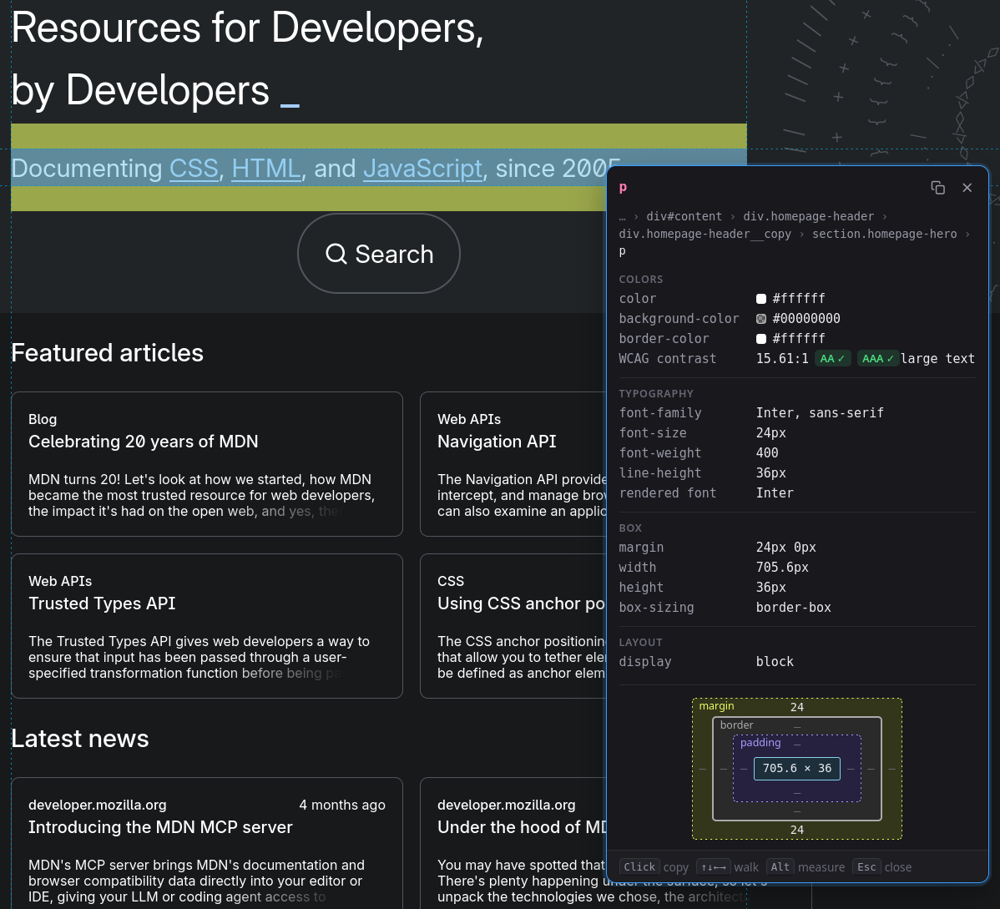

# Scope



A small Firefox extension for checking an element's CSS without opening DevTools.

Hover over an element and hold **Shift**. A tooltip shows the element's key
computed styles, and a blue focus border marks the element being inspected.
Keep holding Shift and move the pointer to inspect other elements. Release
Shift to dismiss it.

Shift is ignored while a text field has focus (inputs, textareas and rich-text
editors), so typing capitals doesn't open the tooltip. Holding Shift on its own
in a field shows a short hint instead. Click outside the field first to
inspect.

To copy values, click while holding **Shift** to pin the tooltip in place. The
click doesn't reach the page, so it won't follow links. Then:

- click a value to copy it, e.g. `#4a7ab8`
- click a property name to copy the declaration, e.g. `color: #4a7ab8;`
- click the copy icon in the top-right corner to copy every row as CSS
  declarations
- drag to select any text as usual

Press **Esc**, press **Shift**, or click anywhere outside the tooltip to close
it.

To turn it off for a site, click the toolbar button and check
**Disable on this site**. This applies to the current hostname straight away,
without reloading the page.

## What it shows

- Colors: `color`, `backgroundColor`, border colors (collapsed to one
  `borderColor` row when all four sides match) and `outlineColor`, as hex
  values with a color swatch
- Contrast: the WCAG 2 contrast ratio of the text against the background it
  sits on, with AA and AAA pass/fail. Translucent backgrounds are blended
  with those behind them, large text uses the lower thresholds, and the
  result is `unknown` over a background image or gradient
- Typography: `fontFamily`, `fontSize`, `fontWeight`, `lineHeight`
- Box: `margin`, `padding`, `width`, `height`, `border`, `borderRadius`
- Layout: `display`, `position`, `opacity`
- A box model diagram with each side's margin, border and padding, and the
  content size. The same regions are shaded on the page: margin in orange,
  border in yellow, padding in green and content in blue

When the hovered state differs from the normal state, both are shown:
`normal → hover`.

## Install for development

1. Open `about:debugging#/runtime/this-firefox`.
2. Click **Load Temporary Add-on…** and select `manifest.json`.

Temporary add-ons are removed when Firefox restarts.

If nothing happens on a page, check the extension's site access under
`about:addons` → Scope → Permissions.

## Release a new version

1. Bump `version` in `manifest.json`. AMO rejects a version that was already
   uploaded.
2. Lint and package with [web-ext](https://github.com/mozilla/web-ext):

   ```sh
   npx web-ext lint
   npx web-ext build --overwrite-dest
   ```

   This writes `web-ext-artifacts/scope-<version>.zip`. Repo-only files are
   excluded via `web-ext-config.mjs`.
3. Upload the zip on [addons.mozilla.org](https://addons.mozilla.org/developers/)
   → Scope → **Upload New Version**, or sign and submit from the command line
   with API keys from **Tools → Manage API Keys**:

   ```sh
   npx web-ext sign --channel=listed \
       --api-key=$AMO_JWT_ISSUER --api-secret=$AMO_JWT_SECRET
   ```

## Permissions

- **Content script on all `http://` and `https://` pages**: reads computed
  styles of the element under the cursor.
- **`storage`**: saves the list of hostnames where it's disabled, locally.
- **`activeTab`**: lets the toolbar popup read the current tab's hostname
  when you open it.

It makes no network requests and stores nothing besides that list.

## License

[MIT](LICENSE)
